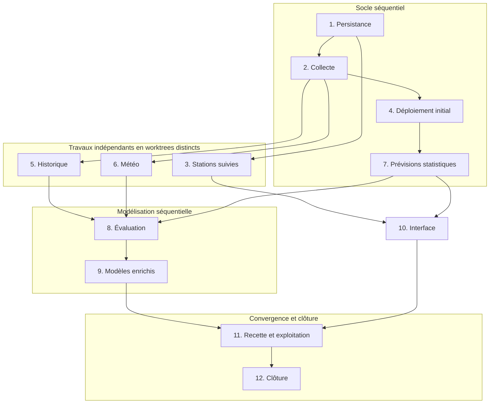

# Vélo’v : collecte autonome et prévisions

## TL;DR

Transpolyon sera déployable sur un petit homeserver, accessible en réseau privé ou VPN.
L’application conservera Vue/Fastify et historisera les stations suivies depuis sa configuration.
SQLite et un worker Python permettront de calculer des prévisions jusqu’à 48 heures sur CPU.
L’utilisateur pourra consulter les probabilités de trouver un vélo, un mécanique, un électrique ou une place, ainsi que les quantités estimées.
Un premier déploiement permettra d’accumuler des observations pendant le développement de la prédiction.
Le backfill restera facultatif et les modèles enrichis devront être évalués face à une référence statistique.
La source de vérité produit est [00-overview.md](00-overview.md), transcription des choix validés dans la conversation ; les instructions explicites ultérieures de l’utilisateur prévalent.
Pour l’avancement, seul [01-backlog.md](01-backlog.md) fait foi. Reprise : `/resume-plan velov-forecast`.

## Points de vigilance

Journal vivant : lorsqu’une implémentation corrige un point, modifier ce point en place et le préfixer par `[Corrigé à l’implémentation de PR N, #NNN]`. Ajouter également une courte note à l’unité correspondante du backlog. Ne pas réécrire silencieusement les hypothèses initiales.

1. **Unités 1 à 3 — Réutiliser le client Grand Lyon et les identifiants existants.** Le client authentifié, la validation Zod et la transformation des disponibilités existent déjà. L’identifiant station exposé est `number`, pas `gid`. La sélection des trajets dans les URL n’est pas la liste des stations suivies.
2. **Unités 2 et 4 — Collecter sans navigateur.** Aujourd’hui, `GET /velov` provoque un appel fournisseur. La nouvelle collecte doit vivre indépendamment des requêtes ; le premier déploiement ne doit pas attendre les modèles ou l’interface de configuration.
3. **Unités 1, 2 et 5 — Un trou de collecte n’est pas une indisponibilité.** Conserver les dates source et de collecte, la provenance et la qualité des observations. Ne pas confondre une réponse répétée avec une panne ou transformer un sous-type inconnu en zéro.
4. **Unités 2 et 3 — Catalogue complet, historique limité.** La carte doit continuer à proposer le réseau complet. Seules les stations suivies sont historisées et prédites ; retirer une station conserve son historique jusqu’à la rétention normale.
5. **Unité 5 — L’accès historique n’est pas acquis.** La qualification initiale a trouvé une référence officielle mais un ancien lien en erreur. Revalider le point d’accès, les dates et les champs avant tout import. Une indisponibilité documentée est une issue prévue, pas une raison d’inventer un endpoint.
6. **Unités 6, 8 et 9 — Éviter la fuite temporelle météo.** Une série historique assemblée ou une réanalyse ne reproduit pas les prévisions connues 48 heures plus tôt. Archiver les prévisions reçues ; pour le backtest, respecter les dates de disponibilité des runs et les transformations apprises uniquement sur le passé.
7. **Unités 7 à 11 — Ne pas attendre huit semaines pour livrer le code.** Ce seuil conditionne la candidature des modèles enrichis en exploitation. Le pipeline, ses tests et l’interface doivent fonctionner auparavant avec la référence statistique ou un état indisponible explicite.
8. **Unités 1, 4, 7 et 11 — SQLite reste sur disque local.** Application et worker partagent le volume, utilisent des transactions courtes et tolèrent la contention. L’application migre avant le démarrage du worker. Ne pas copier à chaud le fichier principal seul pour une sauvegarde.
9. **Unités 7 et 9 — Aucun apprentissage dans une requête HTTP.** Prévisions pré-calculées, entraînement sur un cœur, tâches séquentielles et échantillonnage borné. Un échec conserve la dernière version exploitable.
10. **Unités 3 et 10 — Préserver les usages actuels.** Garder le tableau retourné par `GET /velov`, la carte complète et les URL de monitoring. Suivre la [compétence de design du projet](../../.agents/skills/transpolyon-design-sytem/SKILL.md), avec états lisibles sur mobile et mesures distinctes des estimations.
11. **Toutes unités — Une PR doit porter sa propre mise à jour du backlog.** Les titres sont stables. Ne pas démarrer une unité déjà en review ; les PR parallèles modifieront les mêmes lignes du backlog, à réconcilier sans perdre les coches.
12. **Unité 12 — La clôture est une PR distincte.** L’ouvrir dès la création de la dernière PR fonctionnelle, puis la fusionner après celle-ci. Les procédures d’exploitation doivent survivre à la suppression de ce dossier.

## Séquence

Le graphe décrit les dépendances, pas une autorisation de lancer des sous-agents. Les unités 3 et 4 peuvent avancer indépendamment ; les unités 5 et 6 peuvent avancer pendant la chaîne 4 → 7. Les unités 8 et 10 deviennent indépendantes après leurs prérequis respectifs. Utiliser des worktrees distincts et traiter les conflits de contrats avant l’intégration.

## Fichiers du chantier

| Fichier | Contenu |
|---|---|
| [00-overview.md](00-overview.md) | Contexte, périmètre, décisions, paramètres et références |
| [01-backlog.md](01-backlog.md) | Unique suivi d’avancement et règles de reprise |
| [02-fondations.md](02-fondations.md) | Unités 1, 2 et 3 : persistance, collecte et configuration |
| [03-exploitation.md](03-exploitation.md) | Unités 4 et 11 : déploiement initial et exploitation finale |
| [04-donnees.md](04-donnees.md) | Unités 5 et 6 : historique et météo |
| [05-prediction.md](05-prediction.md) | Unités 7, 8 et 9 : référence statistique, évaluation et modèles |
| [06-interface.md](06-interface.md) | Unité 10 : prévisions dans la carte et le moniteur |
| [07-cloture.md](07-cloture.md) | Unité 12 : transfert des consignes durables et suppression du plan |
